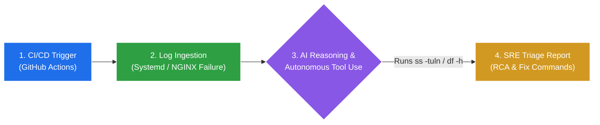

# 🤖 AIOps Autonomous Log Triage Agent

An event-driven **Site Reliability Engineering (SRE) & AIOps workflow** built with **Python**, **Google GenAI SDK**, and **GitHub Actions**. Instead of relying on static `if/else` log parsers, this agent reasons over system failures, autonomously invokes live Linux diagnostic tools, and generates actionable remediation reports.

---

### 🏗️ 4-Step Agentic Architecture



---

### 🔍 How It Works
1. **Trigger & Secure Auth:** GitHub Actions spins up an Ubuntu runner and securely injects `GEMINI_API_KEY` from **GitHub Secrets** at runtime.
2. **Autonomous Tool Calling:** The Python agent exposes read-only diagnostic functions (`get_failed_service_log`, `check_live_listening_ports`, `check_disk_usage`) to the LLM. Upon seeing a port conflict, the model independently executes `ss -tuln` on the live host while skipping unrelated disk checks.
3. **Fault-Tolerant Inference:** Includes an automatic retry loop with multi-model fallback (`gemini-3.5-flash-lite` ↔ `gemini-3.8-flash`) so transient upstream `503` demand spikes never break the pipeline.
4. 4. **Actionable Output & Dashboard:** Produces a structured Root Cause Analysis (RCA) with exact Linux/AWS CLI remediation commands and writes the Markdown report directly to `$GITHUB_STEP_SUMMARY`[cite: 7, 9, 12], keeping a human in the loop before modifying production.
---

### 📊 Live GitHub Actions Triage Dashboard

Instead of digging through raw CI/CD console logs, the agent writes its structured Markdown report directly to `$GITHUB_STEP_SUMMARY`, rendering an executive-ready incident dashboard directly on the workflow run summary page:

 


---

### 📁 Repository Structure

```text
├── .github/workflows/
│   └── aiops-triage.yml   # GitHub Actions CI/CD workflow definition
├── agent.py               # Autonomous SRE agent, tool definitions & Step Summary writer
└── README.md              # Architecture & walkthrough documentation

```

---

### 🚀 Quick Setup

1. **Clone the repository:**
   ```bash
   git clone https://github.com/anu7053/aiops-log-triage-agent.git
   cd aiops-log-triage-agent
   ```
2. **Configure Secrets:**
   In your GitHub repository, navigate to **Settings > Secrets and variables > Actions** and add `GEMINI_API_KEY`.
3. **Trigger the Workflow:**
   Open the **Actions** tab, select **AIOps Incident Triage Workflow**, and click **Run workflow** to generate a live triage dashboard in the run summary.
